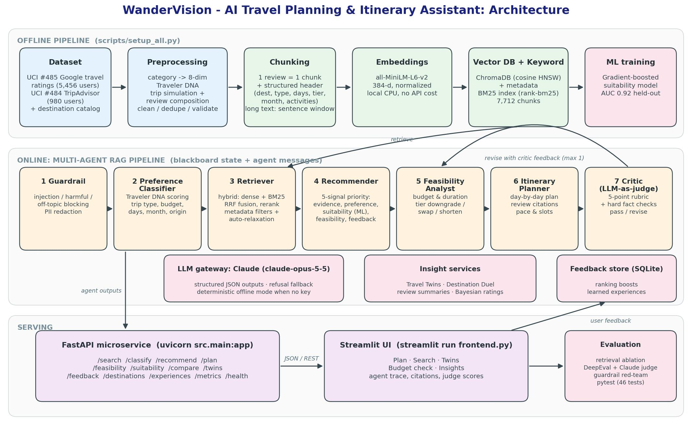

# WanderVision: Design Document

## 1. Problem statement

Travel companies accumulate thousands of reviews and trip records, yet agents answer recurring questions by hand:
*which past trips like this were rated highly?*, *which destination do similar travelers prefer?*, *what can this
budget actually buy?* The goal is a microservice that takes a natural-language enquiry and returns similar
historical experiences, prioritized destination and activity recommendations, and a feasible, evidence-backed
itinerary. Answers must be explainable and safe, and they should improve with feedback.

## 2. Architecture

**Offline pipeline** (`scripts/setup_all.py`): UCI rating matrices → Traveler DNA + trip simulation → cleaning →
record-level chunks with structured headers → MiniLM embeddings → ChromaDB (+ BM25 built in memory at startup) →
suitability model training.

**Online pipeline**: FastAPI routes call an `Orchestrator`, which runs seven agents over a shared blackboard
(`TripState`). Each agent reads earlier outputs, writes its own, posts a message to the next agent, and records a
timed trace entry. The Streamlit UI renders the result, including the trace, so the reasoning stays visible.

**Flow:** Guardrail → PreferenceClassifier → Retriever → Recommender → FeasibilityAnalyst → ItineraryPlanner →
Critic. If the Critic rejects the plan, structured feedback goes back to FeasibilityAnalyst → ItineraryPlanner →
Critic (at most once).

## 3. Technology selection

| Component | Choice | Why | Alternatives considered |
|---|---|---|---|
| LLM | Claude Opus 5.5 via the `anthropic` SDK | Strong instruction following for structured JSON (schema-constrained outputs remove parsing failures); good at rubric judging; server-side refusal fallback for resilience. | GPT-class models (similar capability; we standardized on one vendor so DeepEval's judge and the app match); local LLMs (too slow on CPU for 3 calls per plan). |
| LLM usage pattern | 3 narrow calls (classify, write itinerary, judge), each with a deterministic fallback | Keeps cost and latency bounded; facts (costs, IDs, ranking) never depend on the LLM; the demo works without a key. | A single "do everything" agentic loop: harder to evaluate, slower, and can hallucinate prices. |
| Embeddings | all-MiniLM-L6-v2 (384-d) | Free, local, fast (7.7k docs embedded in ~2.5 min on CPU); our chunks are short so a small model is enough; the ablation shows it is complementary to BM25. | bge/e5-base (≈3x slower; to evaluate if real reviews are used); API embeddings (cost, network dependency). |
| Vector DB | ChromaDB 1.0.20, persistent, cosine HNSW | Native metadata `where` filters (destination, type, rating, budget, month, days), zero-ops local persistence, from the course stack. | FAISS (fast, but metadata filtering would need building by hand); pgvector (needs a database server). |
| Keyword | BM25 (rank-bm25) | Catches exact intents ("kid-friendly", "rushed", activity names) that embeddings blur. Best single retriever in our ablation. | Chroma full-text `$contains` (no ranking). |
| Fusion and rerank | Reciprocal Rank Fusion (k=60) + ms-marco MiniLM cross-encoder | RRF needs no score calibration between retrievers; the cross-encoder improves precision@5/10. | Weighted score sum (needs per-query normalization). |
| ML | HistGradientBoosting | Captures interactions (budget tier x destination cost, season x beach); fast; probabilities feed the ranking. | Logistic regression (kept as a baseline). |
| API / UI | FastAPI + Pydantic / Streamlit + Plotly | Required by the guidelines; Pydantic gives schema-level validation and an OpenAPI page for free. | |
| State | SQLite | Feedback and request logs with zero setup; enough for a single-node service. | Postgres/Redis for multi-instance deployment. |

## 4. Retrieval strategy

- **Chunking.** Reviews are 60-120 words, so one review = one chunk. Splitting would separate a complaint from its
  context. Each chunk is prefixed with a structured header: `Phuket, Thailand | couple trip | 5 days | mid-tier
  budget | Dec | focus: beach | activities: ...`. This lets BM25 and the embedding model match facts the free text may
  leave implicit. Longer external reviews go through a sentence-window splitter (~120 words, 1-sentence overlap).
- **Embedding.** Normalized MiniLM vectors, with cosine distance in HNSW.
- **Retrieval.** Dense and BM25 each return 50 candidates under the *same* metadata filter; they are fused with RRF,
  the top 30 are reranked by the cross-encoder, and relevance is then min-max normalized within the candidate set.
- **Prioritization.** `0.45·relevance + 0.25·rating + 0.20·preference fit (DNA × destination) + 0.10·feedback boost`.
  Ratings are Bayesian-adjusted (prior 8 reviews) at the destination level, so a place with 3 perfect reviews cannot
  beat one with 300 strong ones.
- **Filter relaxation.** The Retriever starts strict (travel type + budget tier + rating ≥ 4) and drops soft filters
  one at a time until it has at least 8 pieces of evidence. Filters the user set explicitly are never relaxed, and
  every relaxation is reported in the UI.
- **Ablation** (14 labelled queries, nDCG@10): BM25 0.762 · dense 0.727 · **hybrid 0.861** · hybrid + rerank 0.862
  (P@10 rises from 0.586 to 0.721 with the reranker, at +0.8 s on CPU).

## 5. Agent design

| Agent | Role | LLM? | Deterministic core |
|---|---|---|---|
| Guardrail | Length checks, prompt-injection, harmful-intent and off-topic detection; PII redaction; numeric sanity checks | No (by design: it runs before any LLM sees the text and cannot itself be injected) | regex + travel lexicon |
| PreferenceClassifier | Traveler DNA (8 scores), segment, trip type, tier, intent, must-haves | Claude, structured schema | lexicon with negation handling; budget, days (including "3 free days", "seven nights", "two weeks"), month (whole-word seasons only), origin (any region after "from") and travelers ("for two", "two people") are always parsed by regex (with currency conversion) |
| Retriever | Query expansion from top DNA dimensions, hybrid search, filter relaxation | No | |
| Recommender | Scores all 32 destinations on 5 signals: evidence (retrieved trips + Travel-Twin ratings), preference fit, ML suitability, feasibility (at the best affordable tier), feedback boost. Ranks activities and attaches praising review IDs. | No | |
| FeasibilityAnalyst | Negotiates the plan: downgrade tier → switch to an affordable alternative (if the user named no destination) → shorten the trip | No (it's arithmetic, so it must be exact) | |
| ItineraryPlanner | Day-by-day plan respecting pace (family 6 h/day … solo 8 h), arrival and departure half-days, evening food slots, no nightlife for families | Claude writes the plan from candidate activities and review snippets; every citation is validated against the allowed IDs and invalid ones are removed | greedy slot scheduler |
| Critic | LLM-as-judge on 5 criteria (preference alignment, groundedness, feasibility, completeness, clarity/safety) | Claude, structured schema | Hard fact checks always run and **cap** the LLM's scores (it can't score groundedness 5 when citations are missing) |

**Communication.** A blackboard (`TripState`) plus explicit addressed messages (`state.post(from, to, content)`).
**Revision loop.** If the mean score is below 3.5, any criterion is ≤ 2, or the plan is over budget (an over-budget plan is never approved), the orchestrator turns the critic's
findings into structured feedback (`must_cover: [nature]`, `tier: budget`) and re-runs Feasibility → Itinerary →
Critic, at most once. This bounds latency and cost while still fixing concrete defects.

## 6. Evaluation strategy

| Layer | Method | Metrics |
|---|---|---|
| Retrieval | 14 queries with rule-based relevance labels; 4-way ablation | P@5, P@10, MRR, nDCG@10, latency |
| Preference classification | 20 labelled queries | travel-type accuracy, top-dimension recall, days/budget/tier/month accuracy, negation handling |
| Guardrails | 15 attacks + 15 benign (incl. PII, and tricky phrases like "ignore the crowds") | block rate, category accuracy, benign pass rate |
| End-to-end plans | 8 scenarios | judge score, pass rate, citation coverage, within-budget rate, preference coverage, latency |
| LLM quality (DeepEval, Claude as judge via a custom `DeepEvalBaseLLM`) | the 8 plans with their retrieved context | Answer Relevancy, Faithfulness, Contextual Relevancy, G-Eval "Recommendation quality" |
| ML | 80/20 stratified split | AUC, accuracy, Brier score vs. logistic and majority baselines |
| Software | 58 pytest tests (unit + API integration) | |
| Web UI | a scripted browser pass over every tab (33 checks), plus a mock API that injects hostile text (dollar signs, HTML, markdown) into plans (18 checks) | no error boxes, no leaked markup, safety blocks shown, results match the expected values in `docs/Test_Inputs.md` |

Results are in `eval/results/Evaluation_Report.md`, regenerated by `python scripts/run_eval.py`.

**Claude-mode results** (`eval/results/LLM_Mode_Runs.md`). Two full runs with `claude-opus-5-5` showed the revision
loop working: couple/Phuket judge 3.4 → revised → 4.0; family/Kerala 3.4 → revised → 3.6. The Claude judge is far
stricter than the rule-based judge (4.6-4.8), and its critiques (extras costed at $0, too many long drives for
young kids, a renamed activity losing its price) each led to a code fix. DeepEval was then run with Claude as the judge on six Claude-written plans (answer relevancy 1.00, faithfulness 1.00,
contextual relevancy 0.77, G-Eval recommendation quality 0.57; Claude's own judge averaged 3.6 / 5 with 5 of 6 approved). It is a small sample chosen to fit a budget.

## 7. Challenges, trade-offs and lessons

1. **The dataset lacks the brief's key fields.** UCI #484/#485 are rating matrices only. *Decision:* keep real
   traveler preference vectors, simulate trips and compose reviews from one shared causal model, and document it
   openly. *Trade-off:* the suitability model partly learns that model back (logistic regression ≈ boosted trees,
   AUC 0.913 vs 0.918), and template text makes the reranker less valuable. A loader for real CSVs is provided.
2. **Native crash in the vector DB.** ChromaDB 1.5.9 segfaulted on Windows. Bisecting showed the cause was
   pyarrow 18 (imported indirectly by pandas) conflicting with Chroma's Rust bindings. *Fix:* pin chromadb 1.0.20 and
   pyarrow ≥ 21 in an isolated venv. Lesson: pin native dependencies and test the exact install path.
3. **Evaluation found ranking bias.** Early runs recommended Kerala for 4 of 8 scenarios. Root causes: (a) the
   recommender judged feasibility at the requested tier while the Feasibility agent would have downgraded it, so
   cheap destinations always won; (b) a 0.3 prior on unmentioned preferences diluted "nature only" requests.
   After fixing both, the scenarios produced 7 different destinations (Maldives for the honeymoon, Cape Town for
   adventure, Paris for culture).
4. **The literal word "budget" was read as the budget tier** ("budget $3000" made the trip a budget-tier trip).
   Fixed with phrase-level patterns and covered by a unit test.
5. **Deterministic vs. LLM agents.** Facts that must be exact (costs, filters, IDs, ranking) are code; language
   tasks (classification nuance, itinerary prose, judging) use the LLM. This makes the system cheaper, testable and
   available offline. The cost is that offline classification is weaker on unusual phrasing; the 100% offline
   preference score reflects a test set written alongside the lexicon.
6. **Latency.** About 3 s per plan on CPU offline: the cross-encoder takes ~0.8 s, and scoring 32 destinations with
   ML explanations ~1.5 s. Models are warmed at startup (otherwise the first query takes 18 s). With Claude, 3-5 LLM
   calls bring it to ~60-90 s including one revision; itinerary effort was lowered from medium to low and tips capped
   to cut it from 124 s.
7. **Region intent.** "8 days of museums *in Europe*" first returned Kyoto because only the origin ("*from*
   India") was parsed. A destination-region parser now restricts candidates and retrieval, and distinguishes "in
   Europe" from "from Europe".
8. **Account-level LLM failures.** When credits ran out, every call failed and fell back individually. A circuit
   breaker now switches the process to offline after the first billing or auth error.
9. **Raw HTML visible in a plan.** Plan text can contain dollar amounts and symbols; Streamlit read pairs of `$` as maths and displayed markup. *Fix:* every piece of API or model text now goes through one set of safe renderers, and a mock API that injects hostile text tests the whole UI. Lesson: treat model output as untrusted text at the display layer too.
10. **An over-budget plan could be approved.** A $2,000 family trip costing $11,704 scored 4.2/5 and passed. *Fix:* the Critic never approves a plan whose budget status is over budget; it is revised once and, if it still does not fit, shown as "Needs a second look".
11. **A clean install failed.** `chromadb` and `deepeval` need incompatible `posthog` versions. *Fix:* DeepEval moved to `requirements-extras.txt`, installed in a second step. Found only because the setup was tested on a fresh environment.
12. **Real sentences exposed parsing gaps** ("3 free days", "for two people", "flying from Oceania", country names, "hot springs" read as a season). *Fix:* parser and alias improvements with unit tests, and a document of copy-and-paste test inputs with measured results.
13. **Security.** Guardrails run before any LLM; user text is passed to Claude as delimited data with an explicit
   "data, not instructions" rule; feedback comments pass the same guardrails before they can enter the knowledge base,
   which prevents index poisoning through the feedback channel; secrets live in `.env` (git-ignored).

## 8. Future work

Real review corpus (e.g. TripAdvisor hotel reviews) and a larger embedding model · learned prioritization weights
from feedback (learning-to-rank) · live pricing and flight APIs · multi-destination itineraries · user accounts with
persistent DNA.
